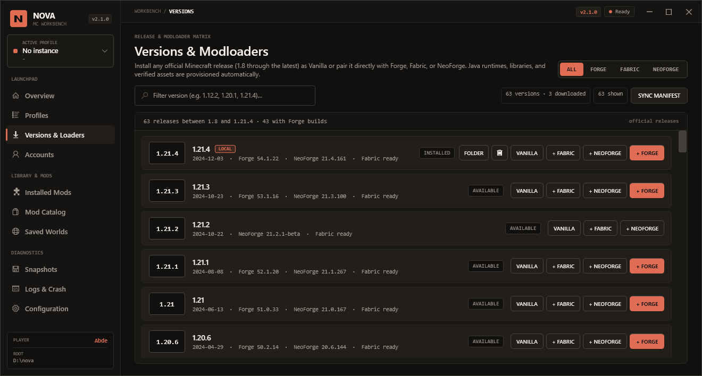
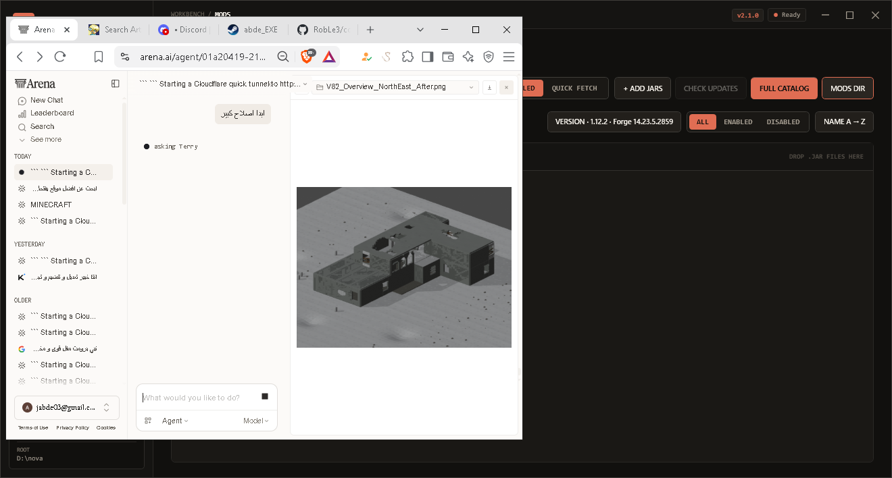

<div align="center">


# Nova Workbench

**High-Precision Portable Minecraft Launcher & Modpack Engine for Windows**

[](https://github.com/abde00037-lang/nova-launcher/releases/latest)
[](https://github.com/abde00037-lang/nova-launcher/actions)
[](https://github.com/abde00037-lang/nova-launcher/releases/latest)
[](https://dotnet.microsoft.com/)
[](LICENSE)

<br />

[**⬇ Download Full Offline Setup (`.exe`)**](https://github.com/abde00037-lang/nova-launcher/releases/latest/download/Nova-Setup-Full.exe) · [**⚡ Web Setup (`66 KB`)**](https://github.com/abde00037-lang/nova-launcher/releases/latest/download/Nova-Web-Setup.exe) · [**📦 Portable `.zip`**](https://github.com/abde00037-lang/nova-launcher/releases/latest/download/Nova-Portable-Full-win-x64.zip) · [**📋 All Releases**](https://github.com/abde00037-lang/nova-launcher/releases)

</div>

---

## Overview

**Nova Workbench** is a fast, self-contained Minecraft launcher, modloader installer, and modpack manager built on **.NET 8 & WPF**. It is designed around a **100% portable, decoupled directory layout** — launcher executables live exclusively inside `bin\`, while your instances, worlds, mods, libraries, Java runtimes, and accounts remain completely isolated and untouched across every update.

<p align="center">
  
</p>

---

## Download & Installation

Choose whichever package suits you best — **no external `.NET` or Java installation is required**:

| Package | Size | Best For | Direct Link |
| :--- | :---: | :--- | :---: |
| **`Nova-Setup-Full.exe`** *(Recommended)* | **~69 MB** | **Complete Offline Installer.** Contains Nova Workbench, `nova-cli`, and the full `.NET 8` runtime embedded inside a single `.exe`. Installs in seconds with Desktop & Start Menu shortcuts. | [**Download Full `.exe`**](https://github.com/abde00037-lang/nova-launcher/releases/latest/download/Nova-Setup-Full.exe) |
| **`Nova-Web-Setup.exe`** | **~66 KB** | **Lightweight Online Installer.** Tiny executable ideal for sharing on Discord/Telegram; automatically fetches and installs the newest GitHub release. | [**Download Web `.exe`**](https://github.com/abde00037-lang/nova-launcher/releases/latest/download/Nova-Web-Setup.exe) |
| **`Nova-Portable-Full-win-x64.zip`** | **~69 MB** | **Zero-Setup Portable Archive.** Extract anywhere (including a USB drive) and run `Start Nova.bat` or `bin\Nova.exe`. | [**Download `.zip`**](https://github.com/abde00037-lang/nova-launcher/releases/latest/download/Nova-Portable-Full-win-x64.zip) |
| **`nova-bin-win-x64.zip`** | **~700 KB** | **OTA Update Payload.** Used automatically by Nova's built-in **1-Click Self-Updater**. | *Handled Automatically* |

---

## Core Capabilities

### 1. Native Multi-Modloader Matrix (`Vanilla` · `Forge` · `Fabric` · `NeoForge`)
- **1-Click Provisioning:** Install any official Minecraft release (`1.8` through `1.21.4+`) cleanly or pair it directly with **Forge**, **Fabric**, or **NeoForge**.
- **Automatic Java Runtime Management:** Automatically detects or downloads the exact portable Adoptium JDK (`Java 8`, `Java 17`, or `Java 21`) required by each Minecraft generation.
- **Parallel Asset & Library Engine:** Multi-threaded SHA-1 verified downloads with real-time byte throughput and per-row progress bars.

<p align="center">
  
</p>

---

### 2. Smart Mod Management & Bulk SHA-1 Mod Updater
- **Instant SHA-1 Update Checker:** Hashes every `.jar` (and `.disabled` mod) in your instance and queries Modrinth's bulk `/v2/version_files/update` endpoint in a single request — scanning 130+ mods in seconds.
- **Atomic Safe Swapping:** Update individual mods or click **`UPDATE ALL`**; files download to `.updating` first and preserve `.disabled` state automatically.
- **Drag & Drop `.jar` Installation:** Drop `.jar` files anywhere onto the Mods page or use **`+ ADD JARS`**.
- **Integrated Modrinth & CurseForge Store:** Search, filter, and install mods with automatic **required dependency resolution** across Forge, Fabric, and NeoForge.

<p align="center">
  
</p>

---

### 3. Modpacks, Diagnostics & World Safety
- **Modpack Import & Export:**
  - Native **Modrinth (`.mrpack`)** and **CurseForge (`.zip`)** pack importer with 8-way concurrent mod downloads and automatic modloader + Java setup.
  - Portable pack exporter with optional world saves inclusion.
- **Doctor Verification & Repair:** Deep SHA-1 integrity audit for client jars, libraries, native DLLs, and assets with 1-click parallel repair.
- **Crash Report Analyzer:** Parses Minecraft/Forge/Fabric crash logs, pinpoints the offending mod `.jar`, and offers a **1-click `DISABLE SUSPECT`** action directly on the alert banner.
- **Non-Destructive World Snapshots:** Automatic or manual `.zip` world backups before launch, with safe side-by-side restoration that never overwrites existing saves.
- **Built-in OTA Self-Updater:** Automatically checks GitHub Releases on launch and upgrades `bin\` in ~3 seconds while keeping 100% of your worlds, mods, accounts, and instances intact.

---

## Portable Directory Architecture

Nova Workbench never scatters files into `%APPDATA%\.minecraft`. Everything stays neatly organized inside its root directory:

```text
NovaWorkbench/
├── Start Nova.bat          # Quick launcher shortcut
├── settings.json           # UI theme, CurseForge token, OTA update channel
├── bin/                    # Launcher & CLI binaries ONLY (swapped during OTA updates)
│   ├── Nova.exe            # WPF Desktop Workbench
│   ├── nova-cli.exe        # Full-featured headless CLI
│   └── Nova.Core.dll       # Shared core engine
├── instances/              # Isolated modpacks & profiles (mods, config, saves)
├── versions/               # Mojang, Forge, Fabric & NeoForge version manifests
├── libraries/              # Shared Maven library cache (deduplicated across packs)
├── assets/                 # Shared Minecraft sound/resource object store
├── java/                   # Auto-provisioned portable JDK 8 / 17 / 21 runtimes
├── backups/                # Timestamped world snapshots (.zip)
└── logs/                   # Launcher & diagnostic logs
```

---

## Command-Line Interface (`nova-cli`)

Every feature in the desktop UI is also scriptable from the terminal via `bin\nova-cli.exe`:

```powershell
# List all installed instances and Java runtimes
nova-cli instances
nova-cli java

# Install modloaders directly
nova-cli forge install 1.20.1 recommended
nova-cli fabric install 1.21.4
nova-cli neoforge install 1.21.1

# Create, health-check, repair, and launch an instance
nova-cli new 1.20.1 --forge recommended --name "Create Pack" --memory 6144 --repair
nova-cli doctor create-pack --deep
nova-cli launch create-pack

# Check and apply SHA-1 mod updates for an instance
nova-cli mods create-pack --check-updates
nova-cli mods create-pack --update

# Import / export modpacks (.mrpack or CurseForge .zip)
nova-cli pack inspect MyPack.mrpack
nova-cli pack import MyPack.mrpack --name "My Modpack"
nova-cli pack export create-pack --worlds

# Check or apply launcher OTA updates
nova-cli self-update check
nova-cli self-update apply
```

---

## Building from Source & Releasing Updates

### Prerequisites
- [**.NET 8.0 SDK**](https://dotnet.microsoft.com/download/dotnet/8.0) on Windows (`win-x64`)

### Local Build
```powershell
dotnet build src/Nova.App/Nova.csproj -c Release -r win-x64 --no-self-contained
dotnet build src/Nova.Cli/nova-cli.csproj -c Release -r win-x64 --no-self-contained
```

### Automated GitHub Release Pipeline (CI/CD)
Pushing any `v*` tag (or running **Actions → Release Nova Workbench** manually on GitHub) automatically compiles and publishes all 4 release artifacts (`Nova-Setup-Full.exe`, `Nova-Web-Setup.exe`, `Nova-Portable-Full-win-x64.zip`, and `nova-bin-win-x64.zip`), notifying all installed launchers via the built-in OTA updater:

```powershell
git tag -a v3.0.0 -m "Nova Workbench v3.0.0"
git push origin v3.0.0
```

---

## License

Released under the [MIT License](LICENSE).  
*Nova Workbench is an independent community launcher and is not affiliated with or endorsed by Mojang Studios or Microsoft.*
