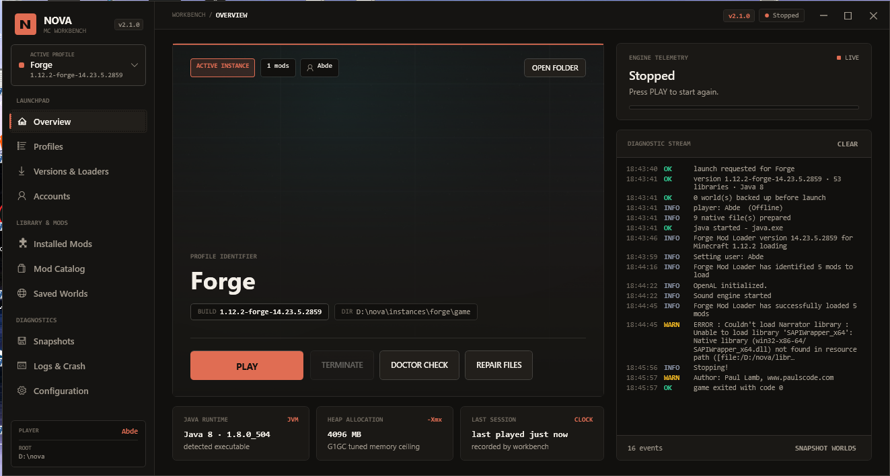

<div align="center">


# Nova Launcher

**Fast, Portable Minecraft Launcher & Safe Modpack Manager for Windows**  
*Featuring the **Nova Workbench** desktop UI & `nova-cli` automation engine*

[**English**](README.md) · [**العربية**](README.ar.md) · [**Changelog**](CHANGELOG.md) · [**Security**](SECURITY.md) · [**Contributing**](CONTRIBUTING.md)

<br />

[](https://github.com/abde00037-lang/nova-launcher/releases/latest)
[](https://github.com/abde00037-lang/nova-launcher/actions)
[-1f2937?style=for-the-badge&logo=windows)](https://github.com/abde00037-lang/nova-launcher/releases/latest)
[](https://dotnet.microsoft.com/)
[](LICENSE)

<br />

[**⬇ Download Full Offline Setup**](https://github.com/abde00037-lang/nova-launcher/releases/latest/download/Nova-Setup-Full.exe) · [**⚡ Web Setup**](https://github.com/abde00037-lang/nova-launcher/releases/latest/download/Nova-Web-Setup.exe) · [**📦 Portable `.zip`**](https://github.com/abde00037-lang/nova-launcher/releases/latest/download/Nova-Portable-Full-win-x64.zip) · [**🔐 SHA-256 Checksums**](https://github.com/abde00037-lang/nova-launcher/releases/latest/download/SHA256SUMS.txt)

</div>

---

## Overview

**Nova Launcher** (powered by the **Nova Workbench** desktop UI) is a fast, self-contained Minecraft launcher, modloader installer, and modpack manager built on **.NET 8 & WPF**.

The portable package keeps the application and its data under a launcher directory rather than `%APPDATA%\.minecraft`. The full installer defaults to `%LOCALAPPDATA%\NovaWorkbench` and can create Windows shortcuts. Back up important data before updates.

<p align="center">
  
</p>

---

## Why Nova Launcher?

*Comparison snapshot as of November 2026 — Prism Launcher and Modrinth App are both great launchers; Nova focuses specifically on a zero-footprint portable folder, lightweight `bin\` OTA swaps, and full GUI + CLI parity.*

| Capability | Nova Launcher | Prism Launcher | Modrinth App |
| :--- | :---: | :---: | :---: |
| **Portable by Default** (zero `%APPDATA%` footprint out of the box) | **Yes** | Optional portable zip | Installed app |
| **Lightweight OTA updates** (updates files in `bin\`; data kept separately) | **Yes** | Full app update | Built-in updater |
| **Account Modes Supported** | **Microsoft + Standalone Offline** | Microsoft (+ offline after MS login) | Microsoft |
| **Native 1-Click Modloaders** (`Vanilla`, `Forge`, `Fabric`, `NeoForge`) | **Yes** | Yes (+ Quilt) | Yes (+ Quilt) |
| **Built-in Mod Sources** (with automatic required dependencies) | **Modrinth + CurseForge** | Modrinth + CurseForge | Modrinth |
| **Crash Suspect Pinpointing + 1-Click `DISABLE MOD` Action** on alert banner | **Yes** | Crash log analyzer & upload | Crash log viewer |
| **Full Headless CLI (`nova-cli`)** for scripting installs, packs, repairs & updates | **Yes** | Launch/import CLI flags | GUI-focused |

---

## Download & Installation

Full packages include .NET 8; Java and Minecraft files are downloaded when needed. Pick the package that fits your workflow. Sizes below refer to v2.1.0:

| Package | Exact Size | Best For | Direct Link |
| :--- | :---: | :--- | :---: |
| **`Nova-Setup-Full.exe`** *(Recommended)* | **72,878,592 B** | **Complete Offline Installer.** Embeds Nova Launcher, `nova-cli`, and the full `.NET 8` runtime in one `.exe`. Installs in seconds without internet and creates Desktop & Start Menu shortcuts. | [**Download Full `.exe`**](https://github.com/abde00037-lang/nova-launcher/releases/latest/download/Nova-Setup-Full.exe) |
| **`Nova-Web-Setup.exe`** | **68,096 B** | **Tiny Online Installer.** Ideal for quick sharing on Discord/Telegram; automatically fetches and installs the newest GitHub release. | [**Download Web `.exe`**](https://github.com/abde00037-lang/nova-launcher/releases/latest/download/Nova-Web-Setup.exe) |
| **`Nova-Portable-Full-win-x64.zip`** | **72,819,042 B** | **Zero-Setup Portable Archive.** Extract anywhere (PC drive or USB stick) and run `Start Nova.bat` or `bin\Nova.exe`. | [**Download `.zip`**](https://github.com/abde00037-lang/nova-launcher/releases/latest/download/Nova-Portable-Full-win-x64.zip) |
| **`nova-bin-win-x64.zip`** | **738,055 B** | **OTA Update Payload.** Downloaded automatically by Nova's built-in **UPDATE & RESTART** banner. | *Handled Automatically* |

### System Requirements
- **OS:** Windows 10 (version 1809+) or Windows 11 — **64-bit (`x64`)**
- **RAM:** 4 GB minimum (8 GB+ recommended for heavy Forge/NeoForge modpacks)
- **Disk:** ~180 MB extracted for Nova Launcher + space for Minecraft assets, portable JDKs, and instances
- **Dependencies:** **None** — `.NET 8` is bundled inside Full packages, and Adoptium Java (`8` / `17` / `21`) is provisioned automatically per Minecraft version.

---

## Accounts, Security & SHA-256 Verification

### How Accounts & Login Work
Nova supports **both** official and offline play seamlessly from the **Accounts** tab:
1. **Official Microsoft Accounts (Device-Code OAuth2):** Sign in securely via Microsoft's official browser device-code flow (`microsoft.com/link`). Nova never sees your password — tokens are stored locally inside `accounts/` and refreshed automatically for online multiplayer servers.
2. **Standalone Offline Profiles:** Create instant local player handles with deterministic offline UUIDs for singleplayer, LAN worlds, and offline-mode servers — no prior online login or internet connection required.

### Windows SmartScreen & Antivirus Transparency
Because Nova Launcher is a free, open-source project without a paid `$400+/yr` commercial EV code-signing certificate:
- Windows Defender SmartScreen may show **"Windows protected your PC"** on first run — click **More info → Run anyway**.
- Heuristic scanners occasionally flag tiny web downloaders (`Nova-Web-Setup.exe`) because they fetch `.zip` archives over HTTPS. If that happens, use **`Nova-Setup-Full.exe`** or **`Nova-Portable-Full-win-x64.zip`**, which contain 100% of files offline.
- For v2.1.0, the four binary assets were built and uploaded by [GitHub Actions run #3](https://github.com/abde00037-lang/nova-launcher/actions/runs/45438579706); `SHA256SUMS.txt` was added separately afterwards. The [current release workflow](.github/workflows/release.yml) is configured to build these packages and generate the checksum file for future releases. GitHub also displays per-asset hashes.

### Release Checksums (`v2.1.0` SHA-256)

Verify any downloaded file in PowerShell with `Get-FileHash <file> -Algorithm SHA256` (or check [`SHA256SUMS.txt`](https://github.com/abde00037-lang/nova-launcher/releases/latest/download/SHA256SUMS.txt) on the [Releases page](https://github.com/abde00037-lang/nova-launcher/releases/tag/v2.1.0)):

```text
a70327929f0d397de66446aee350f630aa0da984a0bef93df26a3266d7fd8315  Nova-Setup-Full.exe
7d7aee48ec9fb1de576f4aacb13ea91e1c41fc1df8c03dccafe3ad396e42b156  Nova-Web-Setup.exe
af01fcdcf97a3aeb1ec15e1fb85dfcfb5bae8549feaf27acbacc07ec71b41c4d  Nova-Portable-Full-win-x64.zip
71a46a2ff9a80f21356c04bc709730711dc56c044b4de343e66156c115c24efd  nova-bin-win-x64.zip
```

---

## Core Features

### 1. Overview Dashboard & Live Telemetry
Real-time diagnostic stream, active JVM & heap telemetry, 1-click **Doctor Check / Repair Files**, and automatic pre-launch world snapshots.

<p align="center">
  
</p>

### 2. Multi-Modloader Matrix (`Vanilla` · `Forge` · `Fabric` · `NeoForge`)
Install any official release (`1.8` – `1.21.4+`) cleanly or pair it in one click with **Forge**, **Fabric**, or **NeoForge**, with automatic Java `8` / `17` / `21` provisioning.

<p align="center">
  
</p>

### 3. Dual Mod Catalog, Drag-and-Drop & Bulk SHA-1 Updater
- **Modrinth + CurseForge Catalog:** Browse and install mods filtered automatically to your instance's Minecraft version and modloader, with required dependencies resolved automatically.
- **Bulk SHA-1 Mod Updater:** Hashes 130+ `.jar` (and `.disabled`) files in seconds against Modrinth `/v2/version_files/update` and swaps updates atomically without losing `.disabled` states.
- **Crash Suspect Disabler:** Automatically parses crash reports and adds a **1-click `DISABLE <MOD>`** button right on the crash alert banner.

<p align="center">
  
</p>

---

## Portable Directory Architecture

```text
Nova/                       # Portable archive root (illustrative)
├── Start Nova.bat          # Quick launcher shortcut
├── settings.json           # Accent theme, CurseForge API key, OTA update channel
├── accounts/               # Saved Microsoft OAuth2 & Offline player profiles
├── bin/                    # Launcher & CLI binaries ONLY (swapped during OTA updates)
│   ├── Nova.exe            # Nova Workbench desktop UI
│   ├── nova-cli.exe        # Headless command-line interface
│   ├── Nova.Core.dll       # Shared core engine
│   ├── hostfxr.dll, hostpolicy.dll, coreclr.dll  # Bundled .NET runtime components
│   └── ...                 # Additional .NET/WPF and app files (not shown)
├── instances/              # Isolated modpacks & profiles (mods, config, saves)
├── versions/               # Mojang, Forge, Fabric & NeoForge manifests
├── libraries/              # Shared Maven library cache (deduplicated across packs)
├── assets/                 # Shared Minecraft asset object store
├── java/                   # Auto-provisioned portable Adoptium JDK 8 / 17 / 21
├── backups/                # Non-destructive world snapshots (.zip)
└── logs/                   # UI & diagnostic logs
```

---

## Command-Line Interface (`nova-cli`)

The CLI defaults to `bin\data` when launched from `bin\`, unlike the desktop UI which uses the parent launcher folder. Pass `--root <launcher-directory>` to use the same data as the UI.

```powershell
# List instances & detected Java runtimes
nova-cli instances
nova-cli java

# Install modloaders directly
nova-cli forge install 1.20.1 recommended
nova-cli fabric install 1.21.4
nova-cli neoforge install 1.21.1

# Create, verify, repair, and launch an instance
nova-cli new 1.20.1 --forge recommended --name "Create Pack" --memory 6144 --repair
nova-cli doctor create-pack --deep
nova-cli launch create-pack

# Bulk-check & update installed mods via SHA-1
nova-cli mods create-pack --check-updates
nova-cli mods create-pack --update

# Import / export Modrinth (.mrpack) & CurseForge (.zip) modpacks
nova-cli pack import MyPack.mrpack --name "My Modpack"
nova-cli pack export create-pack --worlds

# Check or apply launcher OTA updates
nova-cli self-update check
nova-cli self-update apply
```

---

## Frequently Asked Questions (FAQ)

**1. Will updating Nova Launcher delete my worlds, mods, or accounts?**  
The updater copies the staged application files into `bin\`; it does not intentionally delete your instances, worlds, mods or accounts. Back up important data before updating. This is a file overlay, not a binary delta patch.

**2. Do I need to install Java or .NET 8 manually?**  
**For the initial full installation, no separate .NET installation is needed.** The installer contains a compressed portable bundle; on extraction, `bin\` contains the app alongside hundreds of .NET 8/WPF runtime files, including `coreclr.dll`, `hostfxr.dll` and `hostpolicy.dll`. The much smaller OTA archive contains only framework-dependent application files, not the runtime. Its compatibility with a self-contained installation after applying an update still needs verification; keep a backup and use the full installer if needed. Java is downloaded when required (`8`, `17`, or `21`) into `java\`.

**3. How do I enable CurseForge mod search alongside Modrinth?**  
Modrinth works out of the box with zero configuration. To unlock CurseForge search and modpack downloads, paste a free Eternal API key from [console.curseforge.com](https://console.curseforge.com/) into **Configuration → CurseForge API Token**.

**4. Can I move my entire Nova folder to another PC or USB drive?**  
**Yes.** Because all paths inside Nova are resolved relative to the launcher root, you can copy or move the entire `NovaLauncher/` folder anywhere and launch immediately with all instances, mods, and worlds intact.

---

## Building, Security & Contributing

- **Architecture & Local Build:** See [**CONTRIBUTING.md**](CONTRIBUTING.md)
- **Vulnerability Reporting:** See [**SECURITY.md**](SECURITY.md)
- **Release History:** See [**CHANGELOG.md**](CHANGELOG.md)

## License

Released under the [MIT License](LICENSE).  
*Nova Launcher is an independent open-source project and is not affiliated with or endorsed by Mojang Studios or Microsoft.*
